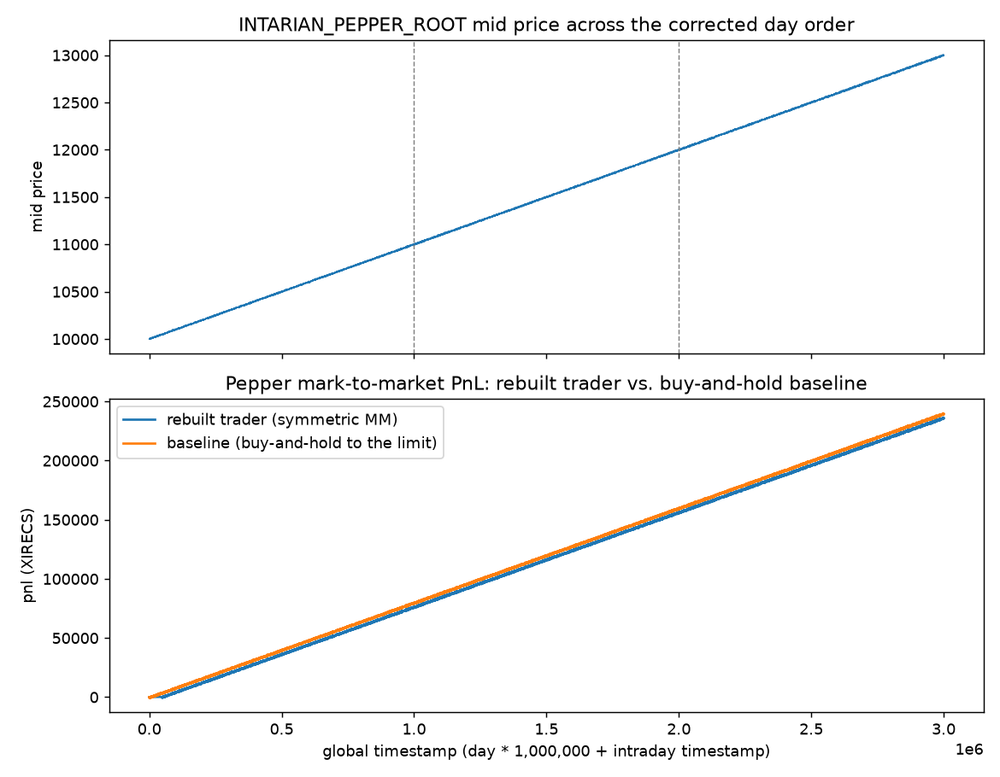
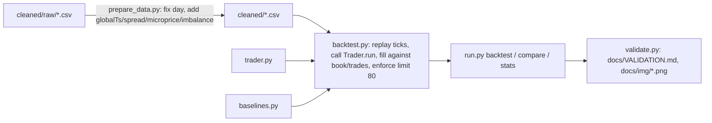

# OpporCode

[](https://github.com/vincal848/imc-prosperity-market-making/actions/workflows/tests.yml)

My market-making work from IMC Prosperity 2026. It covers the tutorial round (Round 0: EMERALDS and
TOMATOES) and Round 1 (ASH_COATED_OSMIUM and INTARIAN_PEPPER_ROOT, position limit 80), plus a rebuild
after the round. The rebuild fixed a pricing bug and a reversed day label in the data, and added a local
backtester so the numbers are honest.

**The headline finding is not flattering.** On INTARIAN_PEPPER_ROOT ("Pepper"), buying to the 80-unit
limit and holding earns 239,471 XIRECS over the round. The symmetric market maker I submitted earns
10,398, and nothing I tried beats holding. On ASH_COATED_OSMIUM ("Ash"), a market maker re-tuned on
day 0 under stressed fills beats a fixed-value baseline on both test days under both fill models. It
is a mean-reversion bet, though: it loses badly on a random-walk version of Ash, and a variance-ratio
guard reduces that loss without meeting its declared bound.


*Top: Pepper's mid price across all three days once the day labels are fixed, one continuous rise
from 10,000 to 13,000. Bottom: buying to the limit and holding beats the rebuilt market maker for the
whole round.*

## Contents

- [At a glance](#at-a-glance)
- [Round 0 (tutorial): EMERALDS and TOMATOES](#round-0-tutorial-emeralds-and-tomatoes)
- [Round 1: the data and the day-ordering bug](#round-1-the-data-and-the-day-ordering-bug)
- [Round 1: what the two products are](#round-1-what-the-two-products-are)
- [Round 1: bots written during the round](#round-1-bots-written-during-the-round)
- [The rebuild: results](#the-rebuild-results)
- [Checks](#checks)
- [How it works](#how-it-works)
- [Decisions](#decisions)
- [Quick start](#quick-start)
- [Repository guide](#repository-guide)
- [Future interests](#future-interests)
- [Notes](#notes)

## At a glance

| | |
|---|---|
| **Rounds** | Round 0 (tutorial, 2 days) and Round 1 (3 days), 10,000 ticks per day, position limit 80 per product |
| **Methods** | Fixed-value and EMA-trend market making (Round 0); Avellaneda-Stoikov-style inventory skew, empirical fill-rate-weighted half spread, vol-shock spread widening, drift t-stat regime switch, variance-ratio mean-reversion guard (Round 1) |
| **Inputs** | The public IMC price and trade exports for both rounds ([`research/data/`](research/data)); `cleaned/raw/` for the Round 1 backtester |
| **Outputs** | `trader.py` (submission-ready), per-tick and per-day mark-to-market PnL, the charts in this README |
| **Validation** | 40 pytest tests: pricing formulas, skew sign/clamp, state round-trip, position-limit compliance, backtester fill/limit invariants, day-ordering correctness, variance-ratio guard |
| **Headline result** | Hold-to-limit (239,471) beats every Pepper strategy tried out of sample. The Ash MM beats its fixed-value baseline on both test days under both fill models, but the variance-ratio guard fails its random-walk bound on 2 of 5 paths |
| **Stack** | Python 3.13, stdlib only for `trader.py`; pandas/numpy/matplotlib for the backtester and analysis |

---

## Round 0 (tutorial): EMERALDS and TOMATOES

Notebooks: [`research/round0/`](research/round0).

### The market


- **EMERALDS** is a fixed-value product. The bots quote 9,992 / 10,008 (10,000 +/- 8) on 96.7% of
  ticks, and mid has a standard deviation of 0.7 across both days. Now and then a bot order lands at
  10,000 or 10,004, and those are the moments a fixed-value trader can take.
- **TOMATOES** drifts. Mid wanders between 4,946 and 5,036 with no anchor, and the bot spread is about
  13 ticks. It needs a moving fair value.

### First bot: one strategy per product (`prosperity_backtest_v1`)

- `EmeraldStrategy` hard-codes fair value at 10,000. It takes any bot order that crosses fair value,
  then rests quotes at 10,000 +/- `HALF_SPREAD`, inside the bots' +/- 8, with a small inventory skew.
- `TomatoStrategy` has three layers:
  1. Fair value = slow EMA + 1.2 x (fast EMA - slow EMA), so the quotes lean with momentum.
  2. The half spread widens with the rolling 80-tick z-score of the mid.
  3. When fast - slow is beyond +/- 0.75, the side that would fight the trend is cut to 25% of its
     size. A small fade is allowed back in at extreme z-scores.


The trend signal fires a lot: across both days, 26-32% of ticks cut bids and 25-28% cut asks. A
3 x 3 x 3 x 3 x 3 grid sweep (243 runs) picked `eSpread=5, tSpread=5, eSkew=1, tFairW=1.2`, for a total
of **+23,472** over the two days.

### Stress-testing on synthetic days (`ProsperityBootstrap`, `prosperity_backtest_v2`)

Two days is very little data to tune on, so I wrote
[`ProsperityBootstrap.py`](research/round0/ProsperityBootstrap.py). It builds a new day by stitching
together randomly chosen 100-tick blocks of a real day (a stationary bootstrap with geometric block
lengths is also available). It keeps each block's order book and trades together and re-stamps the
timestamps.


Across five bootstrap samples, total PnL averaged 41,625 (worst 36,491, best 51,668) and was positive
in all five.

Textbook models and a fill-model lesson (`prosperity_backtest_v3`, `v4`)

I rebuilt the backtest as a generic harness with three quoting rules:

| strategy | idea |
|---|---|
| Naive | quote one tick inside the bot spread, symmetric |
| AS-Adaptive | Avellaneda-Stoikov (2008) reservation price and spread, with rolling sigma^2, kappa from inter-trade gaps, and a trade-direction order-flow tilt (after Cartea et al.) |
| Abernethy-Kale | candidate spreads weighted by exponential weights (Abernethy and Kale, 2013), centered on the A-S reservation price |

v4 drove passive fills from real trade events and printed:

| product | Naive | AS-Adaptive | Abernethy-Kale |
|---|---:|---:|---:|
| EMERALDS | 539,200 | 368,947 | 369,127 |
| TOMATOES | 606,640 | 495,755 | 519,199 |

The naive quoter scored highest on both products. Abernethy-Kale beat AS-Adaptive on both: by 180 on
EMERALDS and by 23,444 on TOMATOES.

---

## Round 1: the data and the day-ordering bug

[`research/round1/clean_round1_data.ipynb`](research/round1/clean_round1_data.ipynb) loaded the three
price and trade files, split them per product, and added `globalTs`, spread, microprice, and book
imbalance. It also did this:

```python
fileDayMap = {"prices_round_1_day_0.csv": 0, "prices_round_1_day_1.csv": 1, "prices_round_1_day_2.csv": 2, ...}
df["day"] = fileDayMap[fileName]   # FORCE day from filename
```

The raw files already have a `day` column, and it's correct: `prices_round_1_day_2.csv` holds
`day = -2`, the **earliest** day. Overwriting it with the filename suffix reversed the chronology.


In the reversed order, Pepper looks like three sawtooth segments with 2,000-point crashes at every
day rollover (the original [`Background_and_Research/PepperGraph.png`](Background_and_Research/PepperGraph.png)).
My research commit at the time was titled "notice drop in the day rollover via vol adjustment", meaning
I read the artifact as a market effect. In true order it's one straight line from 10,000 to 13,000.
[`prepare_data.py`](prepare_data.py) fixes it with `DAY_MAP = {0: 2, 1: 1, 2: 0}`. The full write-up
is in [`docs/BACKGROUND.md`](docs/BACKGROUND.md).

One more data caveat: about 8% of rows in both products have one side of the book missing. On those
rows `mid_price` is the price of the side that exists, or 0 when both sides are empty.

## Round 1: what the two products are


- **Ash** sits around 10,000 for all three days (mean 10,000.2, standard deviation 5.3, range about
  9,982 to 10,017). It's the Round 1 version of EMERALDS, with more noise.
- **Pepper**, with its straight-line trend (about +1,000 per day) removed, leaves a residual of only a
  few ticks. It's nearly a deterministic ramp.

The variance ratio, which compares how far price moves over k ticks with k times how far it moves in
one tick, shows the difference most clearly:


At short horizons both products sit far below 1. That's bid-ask bounce: one-tick mid changes have a
lag-1 autocorrelation of about -0.49 in both. Past about 20 ticks they split. Ash keeps falling, so
over longer windows it goes nowhere, which is what a market maker wants. Pepper turns up and crosses
the random-walk line near 250 ticks, where the drift outweighs the noise. A market maker quoting
around Pepper's mid keeps selling into a rally that never reverses.


Both books leave room to quote inside the bots. Ash's bot spread is 16 ticks on 64% of ticks, and
Pepper's median is 13. Trade flow is similar: about 5.2 units per print, with 1,265 Ash prints and
1,011 Pepper prints.

During the round I also built a signal-hunting toolkit for Ash
([`Research.ipynb`](research/round1/Research.ipynb)). It covers autocorrelation, cycle and FFT scans,
quintile-bucketed forward returns on book features, breakout tests, and markouts of simulated quotes.
The plotting [`dashboard.ipynb`](research/round1/dashboard.ipynb) shows price, spread, book bias,
z-score, and volatility per product.

## Round 1: bots written during the round

Five generations, kept in [`legacy/`](legacy) with notes on what's wrong with each:

| bot | approach | main flaw (pinned by a test) |
|---|---|---|
| `ashTrader.py` | z-score mean reversion around a blended fair value, fixed 2-tick half spread | spread never widens in volatile stretches; the z-score includes the point being scored |
| `pepperTraderC.py` | market making around a hard-coded fair value of 12,474 | ignores the live fair value it computes; quotes into an empty book side |
| `pepperWTradeSignalASH.py` / `...ASH1.py` | Pepper MM supposedly using an Ash trade signal | never reads Ash; the two files are near-duplicates |
| `TraderC1.py` | Avellaneda-Stoikov-style MM for both products (see [How it works](#how-it-works)) | the fair-value clamp truncates instead of rounding |

TraderC1 was the final submission, and it became [`trader.py`](trader.py).

---

## The rebuild: results

The rebuild fixed the day order, built [`backtest.py`](backtest.py), and evaluated every change the
same way. Two backtester fixes changed the numbers. The trader now sees the *previous* tick's trades
while resting quotes fill against the *current* tick's. The buy-and-hold baseline now buys every tick
until position 80; it used to buy once and end at 9 units. Each fix has a test that fails without it.

**Protocols.** [`docs/PROTOCOL.md`](docs/PROTOCOL.md) (19 variants),
[`docs/PROTOCOL-2.md`](docs/PROTOCOL-2.md) (20 more: 6 Pepper regime-switch variants and 14 Ash
market-maker variants), and [`docs/PROTOCOL-3.md`](docs/PROTOCOL-3.md) (4 more: the variance-ratio
guard) were each committed before their experiments. Each one tunes on **day 0 only** and scores days
1 and 2 once. **Total variants tried: 43.** `python walkforward.py tune` reproduces the day-0 search and
writes `docs/tuned.json`. Re-running it drops the `guard` entry, and `python walkforward.py tune3`
re-adds it. `python walkforward.py test` produces the tables below. Stressed fills mean passive fills
at 50% of printed quantity, strictly-through prints only; the Ash MM was tuned under them.

### Pepper


| strategy | fills | day 0 | day 1 | day 2 | total |
|---|---|---:|---:|---:|---:|
| hold-to-limit | either | 79,591 | 79,720 | 80,160 | 239,471 |
| regime switch, \|t\| > 3.7, no overlay (day-0 pick) | normal | 8,273 | 64,673 | 80,160 | 153,106 |
| regime switch (same) | stressed | 10,978.5 | 69,927.5 | 80,160 | 161,066 |
| original market maker (switch off) | normal | 3,020.5 | 4,105.5 | 3,272 | 10,398 |

The original market maker stays within about +/-10 units and earns little. The regime switch waits
for an expanding-window drift t-statistic to cross 3.7 before going to +80. That threshold is the 99th
percentile of the statistic's running maximum on a driftless random walk; a threshold of 2 is hit by
a random walk 40% of the time, so it was ineligible. The position panel shows what waiting costs: the
switch commits late on day 0, exits on a pullback, and doesn't hold 80 for good until partway through
day 1. Out of sample it loses day 1 by 15,047 and ties day 2 exactly.

**Hold-to-limit is the ceiling for a monotone drift under an 80-unit cap.** Pepper rises about 2,993
points over the round (239,471 / 80), so drift PnL is at most 80 x 2,993 = 239,440 whatever the
strategy. Every tick spent below 80 gives up 0.1 points per unit (about 8 per tick at full size), and
a round trip against the spread (about 12 points) only pays if the unit is re-bought within about 120
ticks. The overlay variants (band 10) were worse on day 0. A smarter strategy could only add value by
knowing the regime earlier, which needs a prior (hard-coding the symbol) or data we don't have. So the
regime switch is kept only to route Pepper to the +/-80 core and Ash to market making.

### Ash


| strategy | fills | day 0 | day 1 | day 2 | total |
|---|---|---:|---:|---:|---:|
| fixed-value MM (10000 +/- 2) | normal | 6,523 | 8,381 | 6,082 | 20,986 |
| original learned MM | normal | 8,018 | 8,356 | 7,802 | 24,176 |
| re-tuned MM, no guard (protocol 2) | normal | 8,996 | 11,670 | 9,572 | 30,238 |
| **re-tuned MM + VR guard** (protocol 3 pick) | normal | 9,040 | 11,670 | 9,572 | 30,282 |
| fixed-value MM | stressed | 4,416 | 6,242 | 4,499 | 15,157 |
| original learned MM | stressed | 2,221.5 | 2,329.5 | 2,244 | 6,795 |
| re-tuned MM, no guard (protocol 2) | stressed | 5,569.5 | 8,385.5 | 5,754 | 19,709 |
| **re-tuned MM + VR guard** (protocol 3 pick) | stressed | 5,716.5 | 8,385.5 | 5,754 | 19,856 |

The day-0 pick (by stressed day-0 Ash PnL, coordinate descent) uses half spread 3 (not learned),
unchanged inventory skew, fair value = mean of the last 500 mids (anchor weight 1.0), takes the book
when it is 2 ticks through fair value, and trades size 20. It beats the fixed-value baseline on both
test days under **both** fill models. The original learned MM did not survive the stressed model.

**Variance-ratio guard (protocol 3).** The anchor and the take-the-book rule run only while the
Lo-MacKinlay z of VR(5) over the last 500 mids is below -2.29. That's the 1st percentile of z on
driftless random walks with Ash's volatility, so at most 1% of null ticks engage. Otherwise the MM
quotes passively around the microprice with no anchor or taking. Day-0 stressed picks: 5-passive
5,716.5, 5-flat 5,297.5, 20-passive 5,716.5, 20-flat 5,297.5 (unguarded 5,569.5); the tie between lags
keeps the earlier. On real Ash the guard is on for every tick after the 500-tick warm-up, so days 1-2
match the unguarded MM. The day-0 difference is the warm-up, where passive quoting did slightly better.

## Checks

`python checks.py`; tests in `tests/test_trader.py`.


| check | result |
|---|---|
| null: linearly detrended Pepper | Passes: position never exceeds 13. **Correction:** the first version of this check shifted the book but not the trades, which made the market maker run to -80 and was misreported as the trend mode engaging. The trades are now shifted too, and the old 0.5-threshold configuration also passes this null. |
| null: driftless random walk (5 seeded paths x 10,000 ticks) | The old 0.5 threshold engages; the 3.7 threshold never does. This is the test that fails with the old threshold. |
| placebo: Pepper mirrored | Goes to -80, earns 153,106 (symmetric), no blow-up; hold-to-limit loses 240,511. |
| fill stress | Pepper unchanged for hold-to-limit; see the tables for the Ash MM. |
| null for the Ash MM: shuffled-increment random-walk Ash (seeds 0-4, normal fills) | Unguarded MM: -211,673 / -217,365 / -191,229 / -90,037 / -204,730. Fixed-value baseline: +22,141 / +20,998 / +19,794 / +34,765 / +46,115. **Guarded MM: -31,314 / -54,852 / +21,612 / +16,935 / +67,535.** The guard removes most of the blow-up, but **success criterion 2 (guarded >= baseline - 30,000 on every seed) is not met**: seeds 0 and 1 miss it (-31,314 vs a floor of -7,859; -54,852 vs -9,002). The guard is on for 1.3% / 1.4% / 2.0% of sampled ticks of seeds 0 / 1 / 2 (100% on real Ash), so the remaining loss comes from the passive fallback and the engaged stretches; which one was not diagnosed. |
| planted signals for the guard | A mean-reverting OU series engages it; random walks engage it on <= 2% of ticks (tests). |

Protocol 3 verdict: criterion 1 met (days 1-2 beat the baseline under both fill models, nothing given
back), criterion 3 met (Pepper and the drift nulls are unchanged), **criterion 2 not met** (3 of 5
random-walk paths within the declared bound). Per the protocol it was not retuned. Caveats: one path
per product, three days, and 43 variants with the best chosen on a single tuning day. The 1% engagement
rate is per tick, and a rolling test checked every tick will still fire on some random-walk stretches.
Next hypothesis: require the VR evidence to persist (or use a longer window) before engaging, under a
new protocol.

## How it works



`trader.py` is a single-file, stdlib-only Trader. Per tick and per product it tracks:

- a rolling fair value (the last two-sided microprice);
- a decayed histogram of `|trade price - fair value|`, used to pick the half spread that maximizes
  `fillRate(distance) * distance`;
- a short/long realized-vol ratio, used to detect vol shocks and widen;
- for Pepper only, a short-window drift used to shift fair value and widen further.

Inventory skew follows an Avellaneda-Stoikov-style form, `position * sigma * sqrt(1 / (fillRate *
horizon))`, clamped to +/-4 ticks.

## Decisions

- Kept TraderC1's strategy intact rather than redesigning it. The task was to rebuild and fix, not to
  re-invent the strategy. The one behavioral change (rounding vs. truncating the fair-value clamp) is
  narrow and tested.
- `prepare_data.py` treats the committed `cleaned/raw/*.csv` as the frozen source. The cleaning
  notebook that produced it is now in [`research/round1/`](research/round1), and the raw per-day
  exports are in [`research/data/round1/`](research/data/round1).
- The backtester's fill model is a documented simplification: crossing fills walk the visible book,
  and passive fills cross against printed trades at our own price. IMC's matching engine is not
  public. See `backtest.py`'s module docstring for the exact rules.
- Baselines are deliberately parameter-free: a fixed-value MM for mean-reverting Ash, hold-to-the-limit
  for trending Pepper. The point is to show whether the strategy's complexity earns its keep against
  the simplest sane alternative for each market, not to find the best trivial strategy.

## Quick start

```bash
python -m venv .venv
.venv/Scripts/activate    # .venv/bin/activate on Linux/macOS
pip install -r requirements-dev.txt

python prepare_data.py            # generate cleaned/ from cleaned/raw/ (required first; cleaned/*.csv is gitignored)
python run.py stats               # per-day price stats, shows the Pepper trend
python run.py backtest            # rebuilt trader, both products, all days
python run.py compare             # rebuilt trader vs. trivial baseline, both products
pytest tests -q                   # 40 tests
python walkforward.py calibrate   # protocol 3 variance-ratio thresholds (random walks only)
python walkforward.py tune        # all variants on day 0 (prints the variant count)
python walkforward.py tune3       # protocol 3 guard variants on day 0
python walkforward.py test        # the day-0 picks on days 0-2, both fill models
python checks.py                  # null, placebo, fill-stress checks
python validate.py                # regenerate docs/VALIDATION.md and docs/img/*.png
python research/make_charts.py    # regenerate research/img/*.png (the charts in this README, about a minute)
```

The notebooks in `research/` expect their CSVs in the working directory; copy them in from
`research/data/`. The Round 0 notebooks refer to `..._day_-1.csv` / `..._day_-2.csv`, while the export
names them `..._day_1.csv` / `..._day_2.csv`.

## Repository guide

| Path | Contents |
|---|---|
| `trader.py` | The submission-ready bot (stdlib only) |
| `datamodel.py` | Minimal reimplementation of IMC's public `datamodel` interface |
| `backtest.py` | Deterministic local replay/fill engine |
| `baselines.py` | Trivial comparison traders used by `run.py compare` |
| `prepare_data.py` | Regenerates `cleaned/*.csv` from `cleaned/raw/*.csv`, fixing the day order |
| `run.py` | CLI: `backtest`, `stats`, `compare` |
| `validate.py` | Regenerates `docs/VALIDATION.md` and `docs/img/*.png` |
| `cleaned/raw/` | Frozen pre-fix `allPrices.csv`/`allTrades.csv` |
| `cleaned/` | Corrected prices/trades/analysis CSVs (generated by `prepare_data.py`, gitignored) |
| `walkforward.py`, `checks.py` | Day-0 tuning / out-of-sample scoring; null, placebo and fill-stress checks |
| `docs/PROTOCOL.md`, `docs/PROTOCOL-2.md`, `docs/PROTOCOL-3.md`, `docs/tuned.json` | The evaluation protocols (declared before the experiments) and the day-0 picks |
| `docs/BACKGROUND.md` | Full write-up of the day-ordering bug and why it matters |
| `docs/VALIDATION.md` | Generated numbers (see `validate.py`) |
| `legacy/` | The four superseded bots plus the original TraderC1.py, annotated |
| `research/round0/` | Round 0 notebooks: block bootstrap and backtest iterations v1-v4 |
| `research/round1/` | Round 1 notebooks: data cleaning, Ash research toolkit, dashboard |
| `research/data/` | The public IMC price and trade exports for Rounds 0 and 1, unmodified |
| `research/img/`, `research/make_charts.py` | The charts in this README and the script that regenerates them |
| `research/WALKTHROUGH.md` | The Round 0 and Round 1 story as a standalone document |
| `Background_and_Research/` | Pre-rebuild exploratory plots (`AshGraph.png`, `PepperGraph.png`) |
| `tests/` | pytest suite, sentence-named, no network |

## Future interests

- A sturdier mean-reversion guard (persistence or a longer window), since the first one missed its
  random-walk bound.
- Round 2+ products and IMC's conversions/observations mechanics, which this round didn't exercise
  (`datamodel.py` includes `ConversionObservation` for forward compatibility, but nothing uses it).
- A proper event-driven backtester if IMC ever publishes order-level (not just top-3-level aggregated)
  book data, to drop the passive-fill assumption.

## Notes

- Data provenance: every CSV in this repo comes from IMC Prosperity 2026's public data exports.
  `datamodel.py` mirrors IMC's interface (unpublished as a package) closely enough that `trader.py` is
  submission-compatible, but it is not IMC's code.
- `cleaned/*.csv` is derived and gitignored; `cleaned/raw/` and `research/data/` are committed.
- Backtest timings are single-core on a Windows machine. A full `run.py backtest` (both products,
  60,000 ticks) runs in a few seconds, and `run.py compare` in well under a minute.
- The position-limit and fill-model assumptions in `backtest.py` simplify IMC's real matching engine,
  which is not public. See its module docstring for the exact rules.
