# Walkthrough: Round 0 and Round 1

This walks through both rounds I traded in IMC Prosperity 2026 in the order the work happened: what the
data looked like, what I built, what the backtests said, and which of those results held up later.
The maintained code is at the repo root; this document covers the notebooks in `research/` and how
they led to it.

Every chart here is generated by [`make_charts.py`](make_charts.py) from the raw CSVs in
[`data/`](data) and the repo's own backtester (see [Reproducing](#reproducing)).

- [Round 0 (tutorial): EMERALDS and TOMATOES](#round-0-tutorial-emeralds-and-tomatoes)
- [Round 1: ASH_COATED_OSMIUM and INTARIAN_PEPPER_ROOT](#round-1-ash_coated_osmium-and-intarian_pepper_root)
- [What carried over, and what I'd do differently](#what-carried-over-and-what-id-do-differently)
- [Reproducing](#reproducing)

---

## Round 0 (tutorial): EMERALDS and TOMATOES

### The market

Two days of data (`day -2`, `day -1`), 10,000 ticks per day, position limit 80 per product.

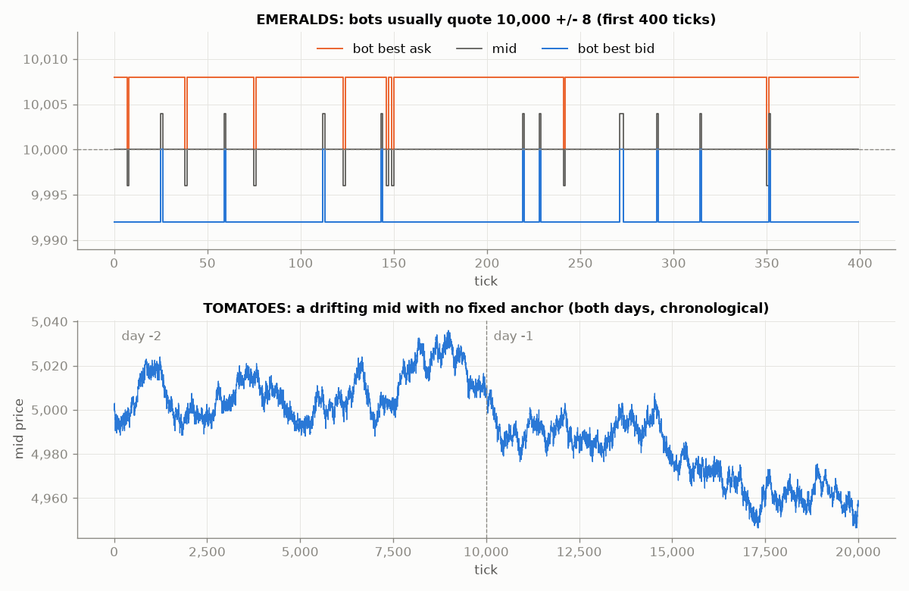

- **EMERALDS** is a fixed-value product. The bots quote 9,992 / 10,008 (10,000 +/- 8) on 96.7% of
  ticks. Mid has a standard deviation of 0.7 across both days. Now and then a bot order lands at
  10,000 or 10,004, and those are the moments a fixed-value trader can take.
- **TOMATOES** drifts. Mid wanders between 4,946 and 5,036 with no anchor, and the bot spread is about
  13 ticks. It needs a moving fair value.

### First bot: one strategy per product (`prosperity_backtest_v1`)

The first notebook split the problem in two:

- `EmeraldStrategy`: fair value is hard-coded at 10,000. It takes any bot order that crosses fair
  value, then rests quotes at 10,000 +/- `HALF_SPREAD`, inside the bots' +/- 8. A small inventory skew
  shifts both quotes against the current position.
- `TomatoStrategy`: three layers on top of the same quoting loop.
  1. Fair value = slow EMA + 1.2 x (fast EMA - slow EMA), so the quotes lean with momentum.
  2. The half spread widens with the rolling 80-tick z-score of the mid.
  3. When fast - slow is beyond +/- 0.75, the side that would fight the trend is cut to 25% of its
     size. A small fade is allowed back in at extreme z-scores.

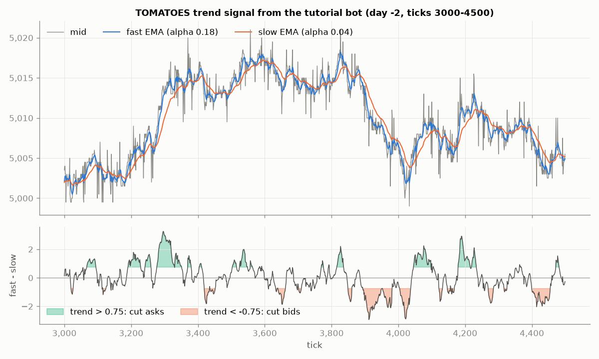

The trend signal fires a lot: across both days, 26-32% of ticks cut bids and 25-28% cut asks. A
3 x 3 x 3 x 3 x 3 grid sweep (243 runs) picked `eSpread=5, tSpread=5, eSkew=1, tFairW=1.2`, for a
total of **+23,472** over the two days.

Looking back, two things in that backtest matter:

- The per-product "PnL" it printed (EMERALDS +130,299, TOMATOES -116,996) is realized cash, without
  marking the open position to market. The total is correct; the split is not. Because TOMATOES ended
  long 26 units, its "-117k" was mostly the cost of inventory still held, not a trading loss.
- `PRICE_FILES` lists day -1 before day -2. The backtest ran the days in reverse chronological order
  and carried the position across the gap. Round 1's data pipeline would make the same ordering
  mistake on a much larger scale (see [below](#data-and-the-day-ordering-bug)).

### Stress-testing on synthetic days (`ProsperityBootstrap`, `prosperity_backtest_v2`)

Two days is very little data to tune on, so I wrote a resampler. `ProsperityBootstrap.bootstrap_day`
builds a new day by stitching together randomly chosen 100-tick blocks of a real day (it also supports
a stationary bootstrap with geometric block lengths). It keeps each block's order book and trades
together and re-stamps the timestamps.

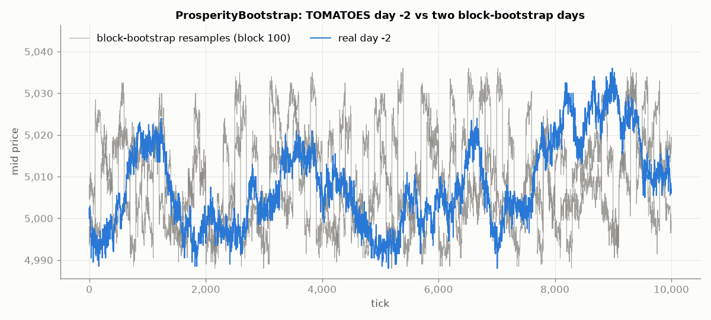

Five bootstrap samples of both days gave a mean total PnL of 41,625 (worst 36,491, best 51,668, 5 of 5
positive). That looked reassuring, but it overstates robustness:

- Every resample reuses the same two days, so the samples aren't independent evidence about a new day.
- Block seams create price jumps the real market never had (visible in the gray paths), and the
  per-product numbers swing by hundreds of thousands between samples. That swing is the
  cash-versus-PnL accounting issue from v1 again, not real risk.

### Trying the textbook models (`prosperity_backtest_v3`, `v4`)

Next I rebuilt the backtest as a generic harness with three quoting rules, each a pure function
`(snapshot, position, state, config) -> (bid, ask)`:

| strategy | idea |
|---|---|
| Naive | quote one tick inside the bot spread, symmetric |
| AS-Adaptive | Avellaneda-Stoikov (2008) reservation price and spread, with rolling sigma^2, kappa estimated from inter-trade gaps, and a trade-direction order-flow tilt (after Cartea et al.) |
| Abernethy-Kale | a ladder of candidate spreads weighted by exponential weights (Abernethy and Kale, 2013), centered on the A-S reservation price |

v4 added the trades files, used real trade events to drive passive fills, and printed this:

| product | Naive | AS-Adaptive | Abernethy-Kale |
|---|---:|---:|---:|
| EMERALDS | 539,200 | 368,947 | 369,127 |
| TOMATOES | 606,640 | 495,755 | 519,199 |

Together those are about 50 times the v1 total, and the simplest strategy wins. The fill engine
explains both.

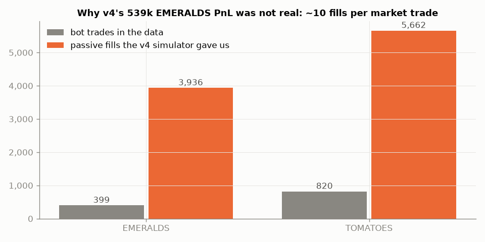

For each snapshot, v4 gathered every bot trade within +/- 500 timestamps, which is 5 snapshots back
**and 5 forward**. Any trade at or through our quote filled our **whole 20-lot quote**, whatever the
trade's actual size. One market trade could fill us at about 11 consecutive snapshots, partly on
trades that hadn't happened yet. EMERALDS had 399 bot trades and the simulator handed the naive quoter
3,936 fills. The naive quoter sat closest to the touch, so it collected the most phantom fills.

I didn't catch this during the tutorial round. It became the main lesson for Round 1: **the
backtest's fill model is the result.** The Round 1 backtester (`backtest.py`) caps passive fills at
the printed trade size, lets the trader see only the previous tick's trades, and has a "stressed"
mode (half the size, strictly-through prints only) to check that a result doesn't depend on generous
fills.

---

## Round 1: ASH_COATED_OSMIUM and INTARIAN_PEPPER_ROOT

### Data and the day-ordering bug

Round 1 had three days, two new products, a position limit of 80, and no conversions.
`clean_round1_data.ipynb` loaded the three price and three trade files, split them per product, added
`globalTs`, spread, microprice, and book imbalance, and wrote the `cleaned_round1/` CSVs that later
became `cleaned/raw/` in this repo.

It also did this:

```python
fileDayMap = {"prices_round_1_day_0.csv": 0, "prices_round_1_day_1.csv": 1, "prices_round_1_day_2.csv": 2, ...}
df["day"] = fileDayMap[fileName]   # FORCE day from filename
```

The raw files already have a `day` column, and it's correct: `prices_round_1_day_2.csv` holds
`day = -2`, the **earliest** day, and `..._day_0.csv` holds `day = 0`, the latest. Overwriting the
column with the filename suffix reversed the chronology.

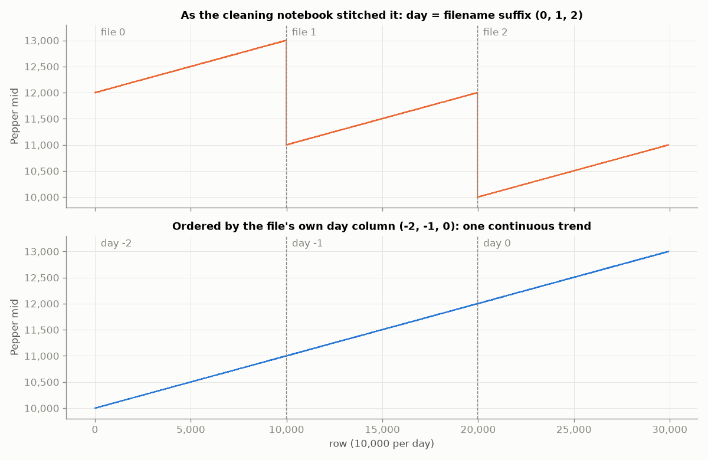

In the reversed order, Pepper looks like three sawtooth segments with 2,000-point crashes at every
day rollover. My research commit at the time was titled "notice drop in the day rollover via vol
adjustment", meaning I read the artifact as a market effect. In true order it's a single straight
line from 10,000 to 13,000. [`docs/BACKGROUND.md`](../docs/BACKGROUND.md) worked out the reversal
from the shape of the data alone, because the cleaning script was missing from the repo. This
notebook is that script, and the raw files confirm the diagnosis directly.
`prepare_data.DAY_MAP = {0: 2, 1: 1, 2: 0}` is the fix.

One more data caveat: about 8% of rows in both products have one side of the book missing. On those
rows `mid_price` is the price of the one side that exists, or 0 when both are empty. The dashboard
and the charts here only use two-sided rows.

### What the two products are

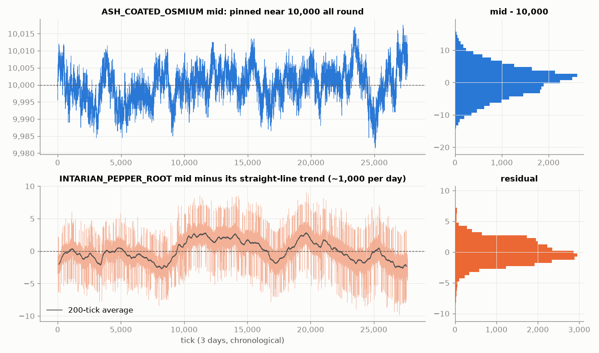

- **Ash** sits around 10,000 for all three days (mean 10,000.2, standard deviation 5.3, range about
  9,982 to 10,017). It's the Round 1 version of EMERALDS, with more noise.
- **Pepper**, with its straight-line trend (about +1,000 per day) removed, leaves a residual of only
  a few ticks. It's nearly a deterministic ramp.

The variance ratio shows the difference most clearly. It compares how far price moves over k ticks
with k times how far it moves in one tick:

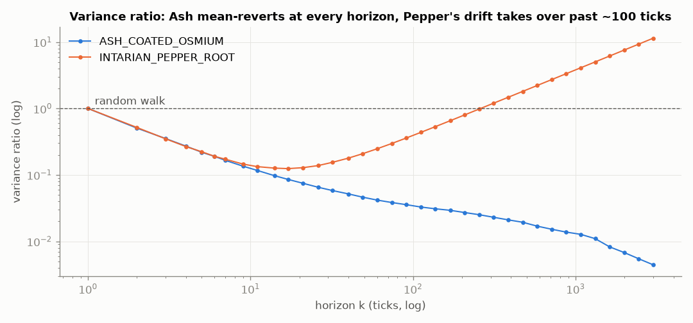

At short horizons both products sit far below 1. That's bid-ask bounce: one-tick mid changes have a
lag-1 autocorrelation of about -0.49 in both. Past about 20 ticks they split. Ash keeps falling, so
over longer windows it goes nowhere, which is what a market maker wants. Pepper turns up and crosses
the random-walk line near 250 ticks, the point where the drift outweighs the noise. A market maker
quoting around Pepper's mid keeps selling into a rally that never reverses.

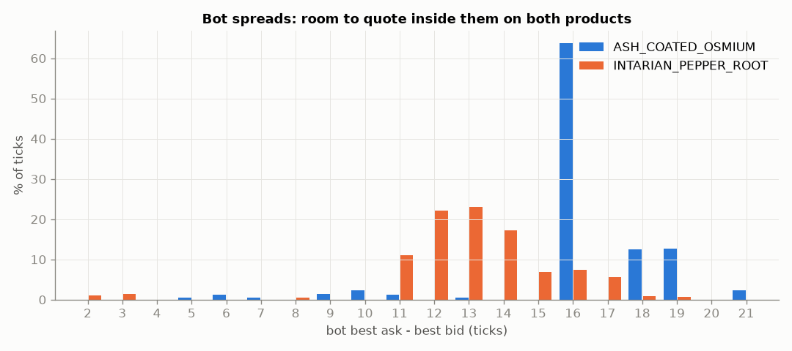

Both books leave room to quote inside the bots. Ash's bot spread is 16 ticks on 64% of ticks (median
16), and Pepper's median is 13. Both products traded similar sizes (about 5.2 units per print) and
counts (1,265 Ash prints, 1,011 Pepper prints).

### Research tooling (`Research.ipynb`, `dashboard.ipynb`)

`Research.ipynb` is a signal-hunting toolkit for Ash. It runs autocorrelation scans of returns and
imbalance, cycle and FFT scans for periodic structure, quintile-bucketed forward returns conditioned
on imbalance, microprice minus mid, spread, recent returns, and volatility, local-extremum and
breakout tests, and markouts of a simulated one-inside-the-touch quote, overall and per regime. It
reads an `ash_round1.csv` that isn't in the export, so the notebook has no saved output.

`dashboard.ipynb` plots, per product: reference price (microprice when the book is two-sided, else
the last good mid) with trades overlaid, spread, microprice minus mid, a within-day rolling z-score,
and rolling volatility. It can also load an IMC submission log zip to overlay a run's PnL. It
concatenated the files in filename order, which is where the sawtooth `PepperGraph.png` came from.

### Bots written during the round

Five generations, all kept in [`legacy/`](../legacy) with notes on what's wrong with each:

| bot | approach | main flaw (pinned by a test) |
|---|---|---|
| `ashTrader.py` | z-score mean reversion around a blended fair value, fixed 2-tick half spread | spread never widens in volatile stretches; the z-score includes the point being scored |
| `pepperTraderC.py` | market making around a hard-coded fair value of 12,474 | ignores the live fair value it computes; quotes into an empty book side |
| `pepperWTradeSignalASH.py` / `...ASH1.py` | Pepper MM supposedly using an Ash trade signal | never reads Ash; the two files are near-duplicates |
| `TraderC1.py` | Avellaneda-Stoikov-style MM for both products: microprice fair value, half spread chosen to maximize fill rate x distance from a decayed histogram of trade distances, inventory skew `position x sigma x sqrt(1 / (fillRate x horizon))` clamped to +/-4, a vol-shock spread widener, and a bounded drift shift for Pepper | the fair-value clamp truncates instead of rounding |

TraderC1 was the final submission. It became `trader.py`.

### After the round: an honest backtest

The rebuild (root README, [`docs/PROTOCOL*.md`](../docs)) fixed the day order, built `backtest.py`
with the conservative fill model described above, and evaluated every change the same way: write
the protocol down first, tune on day 0 only, then score days 1 and 2 once. That's 43 variants in
total across three protocols.

**Pepper.** The right benchmark for a near-deterministic uptrend under an 80-unit cap is to buy 80
and hold.

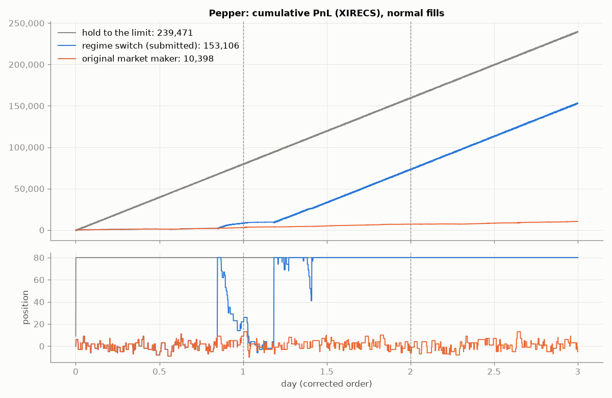

- The original symmetric market maker stays near flat, around +/-10 units, and earns 10,398.
- Hold-to-the-limit earns 239,471. That's close to the ceiling of 80 x the roughly 2,993-point rise.
- The submitted regime switch waits for an expanding-window drift t-statistic to cross 3.7 (the 99th
  percentile of that statistic on a driftless random walk) before it goes to +80. It earns 153,106. The
  position panel shows the cost: it commits late on day 0, exits on a pullback, and doesn't hold 80
  for good until partway through day 1. Day 2 ties the benchmark exactly.

Every unit-tick spent below +80 gives up about 0.1 points of drift. With no prior that Pepper trends,
waiting for evidence is the cost of not blowing up on a product that doesn't.

**Ash.** The benchmark is a parameter-free market maker that quotes 10,000 +/- 2.

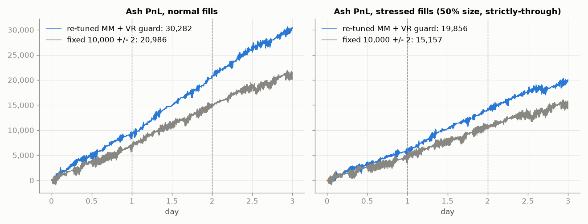

The market maker, re-tuned on day 0 under stressed fills (half spread 3, fair value = mean of the
last 500 mids, take the book 2 ticks through fair value, size 20), beats the baseline on both test
days under both fill models: 30,282 vs 20,986 with normal fills, 19,856 vs 15,157 with stressed fills.
The original learned market maker made 24,176 with normal fills but only 6,795 under stress, so its
edge depended on generous fills.

**Is the Ash edge real or just mean-reversion luck?** Anchoring to a 500-tick mean is a bet that Ash
keeps reverting. To check, I ran the strategy on Ash paths whose tick-to-tick changes were shuffled
into random walks:

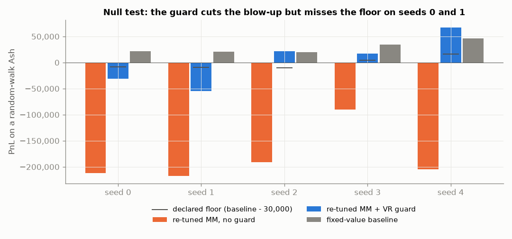

Without a guard it loses about 90,000 to 217,000 per path. The variance-ratio guard (protocol 3)
anchors and takes only while a Lo-MacKinlay VR(5) z-score over the last 500 mids says the series is
mean-reverting, and otherwise quotes passively around the microprice. It's on for 100% of real Ash
ticks after warm-up, so real-data PnL is unchanged, and on for 1-2% of random-walk ticks. It cuts the
blow-up sharply but **misses the declared floor on seeds 0 and 1**, so protocol 3's criterion 2 is
recorded as failed rather than re-tuned until it passed.

---

## What carried over, and what I'd do differently

1. **Check the fill model before the strategy.** In Round 0, v4's best result came from fills that
   didn't exist. Every Round 1 number gets a stressed-fill version for that reason.
2. **Check the timeline before the signal.** Reversed days showed up twice: the reversed file order
   in the Round 0 backtests, and the forced `day` column in Round 1. In Round 1 it hid the single most
   important fact about Pepper.
3. **Use the trivial baseline for each product's character.** Fixed-value MM for a pinned product,
   hold-to-limit for a trending one. The sophisticated Pepper bot lost to "buy 80".
4. **Bootstraps from the same days aren't new evidence.** Synthetic paths that keep the original
   path's structure (or deliberately break it, like the shuffled-increment null) answer more useful
   questions than resampled copies.
5. **Commit the protocol before the experiment** and report the criterion that failed.

## Reproducing

```bash
pip install -r requirements.txt
python prepare_data.py              # builds cleaned/ (needed by the round 1 backtest charts)
python research/make_charts.py      # writes research/img/*.png (about a minute)
```

The notebooks expect their CSVs in the working directory. Copy them from `research/data/round0/` or
`research/data/round1/`, or run the notebook from inside that folder. The Round 0 notebooks refer to
the files as `..._day_-1.csv` / `..._day_-2.csv`, but the export names them `..._day_1.csv` /
`..._day_2.csv` (holding days -1 and -2), so rename the files or change the paths at the top of the
notebook.
